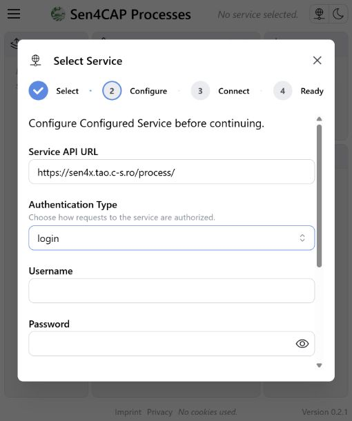

# Improve stand-alone mode

## Problem

When Eozilla App is deployed for a single Processes API, the deployer can
already supply the API URL and authentication settings in `config.json`.
Users still land in the generic **Select Service** wizard. For a Sen4CAP
deployment with `service.authType: "login"`, the form shows editable controls
for the API URL, authentication type, login URL, and token header alongside
the username and password. At the width shown below, users have to scroll past
configuration fields to reach **Next**.

## Steps to reproduce

1. Serve Eozilla App as a stand-alone site with a `service` entry in
   `config.json`. Set `authType` to `login` and supply the API URL, login URL,
   and token header settings.
2. Open the site in a fresh browser session.
3. Observe that the first sign-in is presented as service configuration, even
   though the deployment already supplies those settings.

## Proposed behavior

- For a preconfigured `login` service, open a **Sign in** dialog with **Username**,
  **Password**, and a **Sign in** button. Keep the button visible without
  scrolling past service settings.
- Use the API URL, login URL, authentication type, and token header from
  `config.json`. Keep these settings out of the sign-in form.
- Start authentication when the user submits the form. If sign-in fails,
  show the error in the same dialog and allow the user to retry there.
- Preserve the existing service selection and configuration flow for
  stand-alone deployments without a `service` entry.
